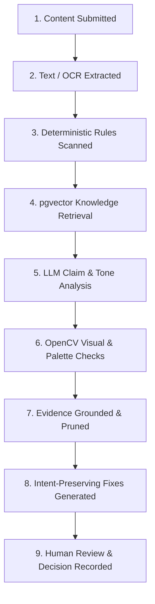

# BrandGuard AI — Brand Governance Platform for Inkloom AI

> **Evidence-grounded brand review prototype for local development**

BrandGuard AI evaluates multi-channel marketing content (advertising copy, press releases, landing pages, and visual creatives) against strict brand guidelines, deterministic rules, and approved enterprise facts.

---

## 🎨 BrandGuard Design System

The interface uses the requested five-color BrandGuard palette:

| Token | Hex Value | Role in UI |
|---|---|---|
| **Oxford Navy** | `#1D3557` | Primary text and navigation |
| **Cerulean** | `#457B9D` | Primary actions and active states |
| **Frosted Blue** | `#A8DADC` | Highlights and progress accents |
| **Honeydew** | `#F1FAEE` | Soft surfaces and page canvas |
| **Punch Red** | `#E63946` | Violations and destructive actions |

---

## ⚡ 9-Stage Compliance Pipeline

BrandGuard runs an explainable, multi-tiered pipeline:


### Evidence-grounded claim states
The AI-assisted claim analyzer uses four explicit states; citations are attached only when the quoted excerpt matches an indexed source:
- `[SUPPORTED]`: Backed by retrieved brand facts and guidelines.
- `[CONTRADICTED]`: Directly refuted by brand documentation.
- `[UNSUPPORTED]`: Factual or performance guarantee without documentation evidence.
- `[UNCERTAIN]`: Ambiguous or missing mandatory qualifying disclosures.

---

## 🚀 Quickstart & Local Setup

### 1. Prerequisites
- Python 3.11+
- Node.js 18+ (Node 20 recommended)
- PostgreSQL with the `pgvector` extension (the included Compose file provides a local database)

### 2. Backend Setup
```bash
cd backend

# Create virtual environment (if not already created)
python -m venv .venv
.\.venv\Scripts\activate   # On Windows (or source .venv/bin/activate on Unix)

# Install dependencies
pip install -r requirements.txt

# Create/update the database schema
python -c "from app.db import init_db; init_db(); print('Database schema ready.')"

# Start the API bound to localhost for local development
uvicorn app.main:app --host 127.0.0.1 --port 8000
```
- API Docs (Swagger): [http://127.0.0.1:8000/docs](http://127.0.0.1:8000/docs)
- Health Check: [http://127.0.0.1:8000/health](http://127.0.0.1:8000/health)

### 3. Frontend Setup
```bash
cd frontend

# Install dependencies
npm install

# Start development server
npm run dev
```
- Web Application: [http://localhost:3000](http://localhost:3000)

---

## 🧪 Automated Testing

Run the automated test suite covering deterministic rules, sentence chunking, explicit claim states, and fix generation:
```bash
cd backend
.\.venv\Scripts\python.exe -m pytest tests
```

---

## Using the workspace

The workspace starts without sample submissions, guidelines, rules, or visual assets. Add your own approved brand documents, rules, and visual references in the Knowledge Base and Visual Identity sections before relying on findings that depend on those inputs. The analysis, review, audit, and intelligence workflows remain available and operate on actual submitted and configured data.

## Security and operating limits

- Accounts authenticate with email and password; browser sessions use expiring, signed, HttpOnly cookies, while the API continues to accept bearer tokens for non-browser clients. Roles and organization membership are loaded from the database for every request. Signing out revokes existing sessions for that account.
- Set `AUTH_SECRET_KEY` to a cryptographically random value of at least 32 characters and keep it private. Production startup refuses an absent or short key. If unset in development, a temporary key is generated at process startup and existing tokens expire on restart.
- Browser cookies are HttpOnly, SameSite=Lax, and Secure in production; state-changing cookie-authenticated requests are checked against the configured frontend origin. Use HTTPS, keep dependencies patched, and deploy a restrictive content-security policy.
- Submissions, uploaded submission files, revisions, submission-level audit events, dashboard lists, and insights are private to the account that created the submission, even when multiple accounts share an organization. Existing records with no identifiable owner remain hidden rather than being exposed to every member.
- Brand guidelines, rules, and visual assets are intentionally shared by members of the same organization so the team uses consistent review standards.
- Every submitted text starts with a versioned snapshot. Edits and accepted/reverted corrections create immutable revision snapshots, invalidate prior approvals, and queue a new compliance review against the revised text. Revision history is available in the submission review.
- Existing user records without a password hash cannot sign in. Set up a new account through registration or provision those accounts through a trusted administrative process; there is no unauthenticated password-reset or account-claim flow.
- Public registration creates a new, separate organization with a manager account; typing an existing organization's name does not join that organization. Invitations, email verification, and self-service password recovery are not implemented.
- Uploads are limited to 10 MB, stored under generated filenames, and restricted by file type. PDF/DOCX ingestion can still depend on the document being parseable; image OCR depends on local Tesseract configuration.
- External LLM analysis is optional and requires `LLM_API_KEY` plus the configured provider settings. Without credentials, deterministic checks continue and AI checks are skipped.
- The `/health` endpoint reports API liveness only; it does not certify PostgreSQL, embeddings, or RAG health.

## Environment variables

Copy `.env.example` to `.env` for Docker Compose and set `DATABASE_URL`, `AUTH_SECRET_KEY`, `LLM_API_KEY`, and `FRONTEND_ORIGIN` as appropriate. For local frontend development, set `NEXT_PUBLIC_API_URL` in `frontend/.env.local` (default: `http://localhost:8000`). Never commit real credentials.